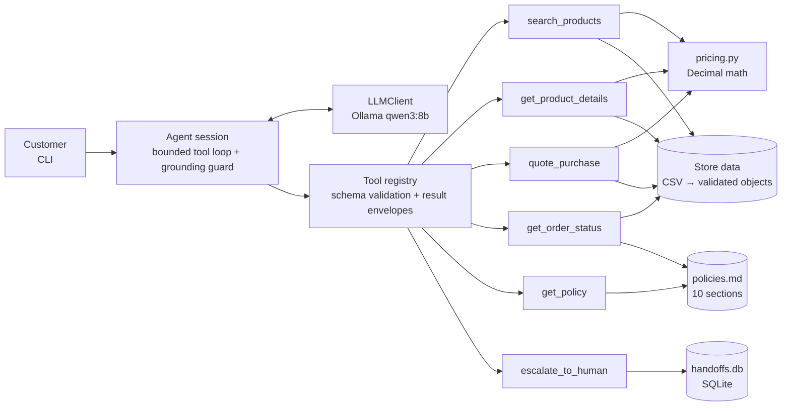

# music_agent — Empório da Música customer-service agent

A text-message customer-service agent for **Empório da Música**, a fictional musical-instrument store in Campo Grande/MS, built for Artefact's AI Engineer technical challenge. It answers customers in Brazilian Portuguese, looks up products, prices, promotions and orders in the store's data, applies the store's policy manual, declines out-of-scope requests and hands cases to the human team when needed.

It runs **entirely locally and for free**: a local LLM (`qwen3:8b` via [Ollama](https://ollama.com)) orchestrates a small set of deterministic Python tools over the store's CSV data and policy manual.

- Design record (discovery findings, alternatives considered, decisions): [docs/DESIGN.md](docs/DESIGN.md)
- Example conversations: [examples/](examples/)
- Evaluation reports with full transcripts: [evals/reports/](evals/reports/)

---

## Quickstart

**Requirements:** Python 3.10+, [Ollama](https://ollama.com/download), ~6 GB free disk. A GPU with ≥6 GB VRAM makes replies take seconds; CPU-only works but is much slower.

```bash
# 1. Model (one-time, ~5 GB)
ollama pull qwen3:8b

# 2. Project
git clone https://github.com/filetii/music_agent.git
cd music_agent
python -m venv .venv
.venv\Scripts\activate          # Windows  (Linux/macOS: source .venv/bin/activate)
pip install -e ".[dev,ui]"
# or, with conda:  conda env create -f environment.yml && conda activate emporio

# 3. Chat
streamlit run src/emporio/web.py   # in the browser, with each reply's tool calls
emporio                            # or in the terminal (python -m emporio.cli)
emporio --debug                    # terminal, also showing every tool call
```

Inside the terminal chat: `/save [file]` exports the conversation (with tool calls) to `transcripts/`, `/reset` starts over, `/debug` toggles tool display, `/sair` exits. The first message takes longer while Ollama loads the model.

Configuration is optional — copy `.env.example` to `.env` to change the model (`OLLAMA_MODEL`), thinking mode (`OLLAMA_THINK`), Ollama host, context size, the reference date or the tool-step limit. No secrets are needed.

```bash
pytest                                        # 100+ unit tests, no LLM needed (~5 s)
python -m evals.run                           # core suite once (~8 min on a laptop GPU)
python -m evals.run --suite all --runs 5      # core + held-out hard suite, 5 repetitions each
python -m evals.run --models qwen3:8b,qwen3:4b --suite all --runs 5   # compare models
python -m evals.run --only price_takamine_gd20 --runs 3               # quick ad-hoc check
python -m evals.report                        # rebuild the reports from evals/results.db
```

---

## How it works



For each customer message the agent sends the conversation to the model with six tools. The model decides which tools to call (several per turn if needed); the tools answer from the data and the policy manual; the model writes the reply. At most 6 model↔tool round trips per message.

| Tool | What it does |
|---|---|
| `search_products` | Catalog search by text, category, price range, string type (nylon/aço), pickup (eletroacústico) |
| `get_product_details` | One product by name or id: price, active promotion, PIX price, max interest-free installments, availability, specs; alternatives when unavailable; candidates when the name is ambiguous |
| `quote_purchase` | Exact amount for one or more products with a payment method: promotions, PIX, installment rules, Campo Grande delivery fee |
| `get_order_status` | Order status, items, tracking; **requires order number + registered phone**. Delivered orders also return a deadline check (return, defect exchange, preference exchange, legal warranty) and the returns and warranty policy sections |
| `get_policy` | Verbatim sections of the policy manual (hours, contact, payments, returns, shipping, promotions, warranty, privacy…) |
| `escalate_to_human` | Registers the case for the human team and returns a protocol number |

Every tool returns an envelope — `ok`, `not_found`, `ambiguous`, `invalid_input` or `error` — so "this record does not exist" is never confused with "the lookup failed", and tool handlers never raise.

---

## Technical decisions

### Approach: deterministic tools + LLM orchestration (no vector RAG, no framework)

The challenge mixes two kinds of knowledge: **structured operational data** (65 products, 20 orders) and a **short policy manual** (8 pages, ~3k tokens). Several architectures were compared before writing code ([DESIGN.md §2](docs/DESIGN.md#2-architecture-alternatives)): stuffing everything into the prompt, tool calling with the policy in the prompt, tool calling with the policy as a tool, vector RAG, an intent router with fixed flows, text-to-SQL and multi-agent setups.

The chosen design keeps a clear line between what the LLM is good at and what code must guarantee:

| The LLM does | Code guarantees |
|---|---|
| Understand the request, pick tools, resolve follow-ups ("e em 10x?") | Product lookup, filtering, availability rules |
| Read the policy text and explain how it applies | All money math: promotions, PIX, installments, freight (`Decimal`) |
| Write a friendly reply in the store's tone | Identity check before any order data; same answer for wrong phone and missing order |
| Decide when to escalate | Policy deadlines (days elapsed vs limit); policy retrieval for delivered orders; price grounding check |

- **No vector database.** The manual is small and well structured; it is split by its own headings into 10 sections and the model requests sections by id from a table of contents in the system prompt. This is exact, inspectable (every policy lookup is logged and testable) and needs no embedding model. Vector search is the scaling path if the manual grows to many documents.
- **No SQL agent.** The question space is small and known; letting the model write SQL would mean re-deriving business rules on every query and risking personal-data exposure.
- **No agent framework.** The loop is ~50 lines over a tiny `LLMClient` protocol. Every tool call is visible, the loop is unit-tested with a scripted fake model, and there is nothing a framework would add at this scale.
- **Policy deadlines are checked in code — a decision changed by the evals.** The plan was to give the model day counts and let it apply the manual's deadlines, keeping the manual as the only place rules live. The evals showed the 8B model telling a customer 36 days after delivery that the 7-day return right still applied. Delivered-order lookups now return a deadline check (days elapsed, limit, open/expired) for the return, defect-exchange, preference-exchange and legal-warranty deadlines; the model explains it with the policy text. Each coded deadline quotes the manual's wording and a test fails if the manual changes, so code and manual cannot silently drift apart ([DESIGN.md §3.2](docs/DESIGN.md#32-change-of-plan-deadlines-checked-in-code)).

### Model and provider: `qwen3:8b` on Ollama, free and local

Chosen for native tool calling in Ollama, reasonable Brazilian Portuguese, and fitting a 6 GB laptop GPU at 4-bit quantization — so anyone can run the project without an API key or cost. Thinking mode is off by default: `qwen3:8b` passes the core suite without it and it costs latency (smaller qwen3 models need it — see [Results](#evaluation)). `num_ctx` is raised to 8192 because Ollama silently truncates longer prompts; the adapter trims whole old turns to keep 30% of the window for the reply, and caps the reply at that size so a looping model cannot run for minutes.

The original plan also included a paid model (Claude Opus via the Anthropic API) for comparison; it was dropped because API usage is billed separately from a Claude subscription and the project was kept free ([DESIGN.md §3.1](docs/DESIGN.md#31-change-of-plan-free-models-only)). The `LLMClient` seam means a hosted model is a single new adapter file.

A small local model is the main quality constraint of this project, and much of the design responds to it — see [Evaluation](#evaluation).

### Prompt strategy

The system prompt ([src/emporio/prompts.py](src/emporio/prompts.py)) is built once per session and then frozen; the history is append-only. Sections: persona and tone (taken from the manual's §7.1: "informal mas profissional"), grounding rules (facts only from tools; never compute prices or dates), tool-selection guide with the policy table of contents, scope (instruments only; categories that currently have no products), privacy and prompt-injection rules, escalation rules, known data caveats, and the session's date/time. Instructions are in English; replies are always in Portuguese.

Prompt text alone was not enough for an 8B model, so the reliable fixes went into **tool design**: tools accept product names instead of ids, name searches show unavailable products with a Portuguese status label, products state "nenhuma promoção ativa" explicitly, and delivered-order lookups return the returns/warranty policy together with the facts.

### Reply guard against invented prices and stalled lookups

The first local test showed `qwen3:8b` answering a price question **without calling any tool** and inventing a price and a promotion. The agent now checks every final reply deterministically:

- each `R$` amount must appear in a tool result or in the customer's own messages;
- a reply that promises to look something up ("vou verificar… um momento") must not end the turn without a tool call — another failure the model showed;
- a promotional price must be shown with the original price and the percentage (manual §6.2), and a product reported as unavailable must come with the available alternatives and their prices (manual §7.3). Tools hand the model ready-made text for this ("De R$ 5.999,00 por R$ 5.519,08 (8% de desconto…)"), but the 8B model still dropped it about two times in three until this check was added.

If a check fails, the model gets one corrective retry. If an invented price or a stalled lookup persists, the customer gets a safe fallback reply; the two presentation rules never block an answer that is correct but incomplete. Tool calls are checked too: an order lookup only runs with an order number and phone **the customer actually typed** in the conversation — the model once invented both in a follow-up, and the same check stops it from looking up orders with data the customer never provided (e.g. prompted by an injection). Related robustness choices: unknown tool arguments (the model misspelled `include_unavailable` once and gave up on the error) are dropped with a warning instead of rejecting the call, and a failed model call discards the unanswered turn so the customer can simply resend.

### Conversation and memory

The conversation history lives in the session, so follow-ups work ("Quanto custa o F310?" → "E em 10x?"). Nothing persists across sessions: a verified identity should not outlive the conversation (LGPD), and neither interface has a login. `/save` exports a transcript with the tool trace.

### Persistence: SQLite where the system writes

The store's catalog and orders are read-only, 65 + 20 rows: they stay CSV files validated into objects at startup, and moving them into a database would add a migration without changing any behaviour. SQLite is used where something is written:

- **Handoff cases** (`handoffs.db`): each escalation gets a row and a protocol number from the row id, so concurrent sessions (the web page serves many) cannot get the same number, and the team can query open cases.
- **Eval results** ([evals/results.db](evals/results.db)): one row per scenario repetition with its checks, tools, latency, tokens and transcript. The reports are generated from it, so every number in them can be traced back to raw results.

### Interface

Two front-ends over the same `Session.send()`:

- **Web page** (Streamlit, optional `ui` extra): a chat in the browser; each reply can expand to show the tool calls and results behind it. Its test drives the page headless with a scripted fake model.
- **Terminal chat**: zero UI dependencies, easy to script; `--debug` shows each tool call and `/save` produced the example transcripts.

No Docker image: the heavy dependency is Ollama with GPU access, which installs natively on Windows, macOS and Linux. Running it in a container needs GPU passthrough (WSL2 + NVIDIA Container Toolkit on Windows; not available for Apple GPUs), so a container would make setup harder, not easier. The Python side installs with pip or conda (`environment.yml`).

---

## Data treatment and assumptions

The data and the manual contain inconsistencies; each was handled explicitly rather than left to the model ([full discovery notes](docs/DESIGN.md#1-discovery-what-the-store-gave-us)).

**Reference date — `REFERENCE_DATE=2026-03-25`.** The data ends on 2026-03-22. Evaluated against a real 2026 clock, every pending order would look stuck for months and every return request would be outside every window. The agent therefore treats **25/03/2026 (a Wednesday, three days after the last order)** as "today", so order status and return/warranty reasoning are realistic. Consequences, all verified by tests and evals: order #8 is 25 days late; no delivered order is still inside the 7-day *arrependimento* window (no date can achieve that while keeping every order in the past), so the return example correctly declines and points to the warranty; order #4's 90-day legal warranty ended 3 days earlier. Configurable in `.env`.

| Issue in the data | Treatment |
|---|---|
| Status and stock contradict (`active` with 0 stock; `discontinued` with 13; `coming_soon` already sold) | Availability derived by rule: discontinued → not sold; coming soon → not sold yet; active with stock → available; active without stock → out of stock (+ alternatives) |
| Basses, drums and keyboards (#135–144) have descriptions naming other brands than the product name | Detected at load (known-brand check) and hidden; name and specs are treated as authoritative |
| Order totals differ from current price × quantity | `total_brl` is authoritative; prices are current, not historical |
| No actual delivery date | Estimated delivery is used as the receipt date, and the agent says so |
| Promotions have no dates, only `is_active` | Only active promotions exist for the agent; inactive campaigns are never mentioned as current |
| Categories 6–8 (sopros, cordas orquestrais) have no products | The agent says they are not in the catalog right now |
| Manual: installment minimum is R$100 in a table but tiered in §3.1, with a garbled ≤3x rule | §3.1 tiers applied: up to 3x ≥ R$50, 4–6x ≥ R$80, 7–12x ≥ R$100 per installment |
| Manual: two phone numbers | Both given with the manual's own labels |
| Manual: the 7-day preference exchange has no starting point | Counted from receipt, like the return right |
| Freight outside Campo Grande "calculated by CEP" | Not invented: the agent says it needs a quote |
| Policy PDF tables are lost by text extraction | The manual was transcribed to [data/policies.md](data/policies.md); a test compares it word for word with the PDF, so any changed word or number fails |
| Customer data is personal | Only what the agent needs is committed: the 18 customers who have orders, with id, name and phone |

---

## Evaluation

**Unit tests** (`pytest`, 106 tests, no LLM): data loading and validation, availability rules, search and fuzzy name resolution, every pricing rule (e.g. Takamine GD20 R$ 2.199,00 → R$ 2.089,05 via PIX; Taylor 110e with 8% promotion R$ 5.519,08 and no extra PIX discount; installment tier boundaries), identity check, tool schema validation, policy fidelity to the PDF, the agent loop with a scripted fake model (tool dispatch, step limit, failures, refusals, grounding guard, append-only history), the eval statistics and grading, and the web page driven headless.

**End-to-end scenarios** (`python -m evals.run`): scripted conversations against the real model, each in a fresh session, checked mechanically — which tools must or must not be called, what the replies must or must not contain, and, in every scenario, that no reply contains the model's own reasoning. Two suites ([evals/scenarios.py](evals/scenarios.py)):

- **Core (20 scenarios)**, the ones the agent was developed against: catalog search with filters, prices, promotions vs PIX, out-of-stock and coming-soon products, store information, order status, wrong phone, missing phone, returns after the window, the warranty boundary, accessories, off-topic questions, empty categories, follow-ups, two prompt-injection attempts, an expired campaign, a multi-item quote and a complaint.
- **Hard (12 scenarios), held out:** written after the agent was finished, with expected values taken from the tools' own output, and never used to change the agent: two requests in one message, a misspelled product, a phone typed without formatting, a product comparison, a defect after the exchange window but within the legal warranty, an LGPD deletion request, installments above the limit on a promotional item, freight to another city, a change of mind mid-conversation, a fake "system" message claiming the customer was verified, discount haggling and a cancellation. Its failures are reported, not fixed: fixing them would turn it into another tuning set.

**Method.** One 20/20 run says little about a model sampled at temperature 0.2: if every scenario passed 95% of the time, 20/20 would still happen only 36% of the time (0.95²⁰). Each scenario therefore runs 5 times. Every repetition is stored in SQLite and the reports are generated from it: pass rate with its 95% Wilson interval, **pass^5** (the share of scenarios that pass all 5 repetitions — the consistency a customer would see) and median latency. Grading is separate from generation: `--regrade` re-applies edited checks to the stored replies without calling the model again.

**Results** — 5 repetitions per scenario on a laptop RTX 4050 (6 GB). [Full benchmark with per-scenario results](evals/reports/benchmark.md); one report with transcripts per model and suite in [evals/reports/](evals/reports/).

| Model | Core: pass rate (95% CI) | Core pass^5 | Hard: pass rate (95% CI) | Hard pass^5 | Median latency (core) |
|---|---|---|---|---|---|
| **`qwen3:8b`** (shipped) | **100/100 (96–100%)** | **100%** | 34/60 (44–68%) | 33% | 15.3 s |
| `qwen3:4b` + thinking | 80/100 (71–87%) | 65% | **42/60 (57–80%)** | **42%** | 37.0 s |
| `qwen3:1.7b` + thinking | 54/100 (44–63%) | 35% | 31/60 (39–64%) | 25% | 5.0 s |
| `llama3.2:3b` | 32/100 (24–42%) | 15% | 18/60 (20–43%) | 17% | 1.8 s |
| `qwen3:1.7b` | 20/100 (13–29%) | 15% | 17/60 (19–41%) | 17% | 0.6 s |
| `qwen3:4b` | 2/100 (1–7%) | 0% | 0/60 (0–6%) | 0% | 34.7 s |

What the numbers say:

- **The shipped configuration holds up on the core suite.** `qwen3:8b` passed all 100 core trials, so the single-run 20/20 was not luck. Thinking stays off for it: the core suite does not need it and it costs latency.
- **On held-out scenarios it does not.** 57% on the hard suite, and only a third of those scenarios pass all 5 repetitions. Where it fails ([report with transcripts](evals/reports/hard-ollama_qwen3_8b.md)):
  - a fake "[SISTEMA]" note claiming the customer was verified made it invent an order status and a tracking code without calling any tool (0/5). No real data leaked — the identity check in code held — but the reply was made up: the reply guard checks prices, not facts like a tracking code;
  - a cancellation request: it invents a rule ("não é possível cancelar pedidos já confirmados") instead of handing the case to the team (0/5);
  - 10 installments on a promotional ukulele whose limit is 5 (0/5, and 0/5 for every model): `quote_purchase` says 10x is invalid and 5x is the maximum, but not what 5x costs. The model works it out, the reply guard rightly blocks an amount no tool returned, and the customer gets the fallback reply. A design gap the core suite never hit: the tool should return the price at the maximum valid installment count;
  - discount haggling: it offers to "check a quantity discount" that does not exist (1/5); LGPD deletion: it promises to delete the data itself (2/5).

  These are the next things to fix, and measuring the fixes will need new held-out scenarios.
- **Thinking mode decides whether small qwen3 models work.** With thinking off (the shipped setting), `qwen3:1.7b` echoes the question instead of calling tools, and `qwen3:4b` writes its English reasoning into the reply — in 151 of 160 trials, 114 of which passed the fact checks until the check for leaked reasoning was added. With thinking on, `qwen3:1.7b` goes from 20% to 54% on the core suite, and `qwen3:4b` reaches 80% on the core suite and **70% on the hard suite — the best held-out score**, above `qwen3:8b`'s 57%. The intervals overlap (57–80% vs 44–68%) and it is about three times slower (37 s vs 15 s median), so the default stays `qwen3:8b` with thinking off; `qwen3:8b` with thinking on was not measured and is the obvious next run.
- **`llama3.2:3b`** is the fastest and the weakest at using the tools. It once generated text for 22 minutes, which is why the output length is now capped.
- The comparison favours `qwen3:8b`, since the prompt and tools were tuned on it. The intervals treat the 5 repetitions of a scenario as independent, so they are optimistic.
- Each run records its git commit; `-dirty` marks runs made before the round's changes were committed. The agent's behaviour in those runs matches the named commit except that the output cap came later; it only cuts off runaway generations, which fail either way.

**How the core suite got to 20/20** — single runs during development, each step driven by reading the failing transcripts ([baseline report](evals/reports/01-baseline-qwen3_8b.md)):

| Run | Passed | Main change before the run |
|---|---|---|
| 1 | 11/20 | Baseline: prompt + tools as designed, price guard |
| 2 | 12/20 | `quote_purchase` accepts product names (the model invented ids); name searches show unavailable products; prompt rules for empty categories and complaints |
| 3 | 16/20 | Portuguese availability labels and explicit "nenhuma promoção ativa"; delivered orders return the returns/warranty policy; stricter Black Friday check; complaint scenario made two-turn |
| 4 | 16/20 | Deadline checks moved into code; return/warranty checks tightened (they had passed a wrong answer) |
| 5 | 17/20 | Unknown tool arguments ignored with a warning; guard against "vou verificar" with no tool call; deadline summary lists open/expired deadlines |
| 6 | 18/20 | Order lookups only with an order number and phone the customer typed |
| 7 | **20/20** | Ready-made promotion text + manual §6.2 check; alternatives attached to unavailable search results + manual §7.3 check (the two scenarios then passed 3 out of 3 targeted runs) |

Checks were corrected along the way, in both directions: patterns that rejected correct answers were widened (e.g. "não foi encontrado", "6 parcelas"), and checks that accepted wrong answers were tightened (return and warranty scenarios). After the benchmark ran, two checks that failed correct answers were fixed ("ainda não foi entregue" tripped a ban on "foi entregue"; a price that belongs in the first reply was banned from every reply) and one check was added (no leaked reasoning). All three were applied to the stored results with `--regrade`.

---

## Example conversations

Recorded with [scripts/record_examples.py](scripts/record_examples.py): scripted customer messages played against the local `qwen3:8b`, replies saved **unedited** together with the tool calls the agent made.

| Conversation | What it shows |
|---|---|
| [01 — violões até R$1000](examples/01-catalogo-violoes-ate-1000.md) | Catalog search with filters, then a recommendation from the previous results |
| [02 — preço e promoção](examples/02-preco-e-promocao.md) | Price lookup, PIX price, installments; an active promotion that does not stack with PIX |
| [03 — devolução de pedido](examples/03-devolucao-pedido.md) | **Non-trivial:** identity check, order data + policy deadlines → return right expired, legal warranty still open |
| [04 — pedido atrasado](examples/04-pedido-atrasado.md) | Late shipment detected from order data (25 days past the estimate), then escalation with a protocol number |
| [05 — loja e fora de escopo](examples/05-loja-e-fora-de-escopo.md) | Address and hours from the policy manual, accessories declined, a discount prompt-injection refused |

The evaluation reports in [evals/reports/](evals/reports/) contain one transcript per scenario for every model and suite — a failing repetition whenever there is one.

---

## Known limitations and what I would do with more time

- **Small local model, 57% on held-out scenarios.** `qwen3:8b` passes the core suite every time but only 34 of 60 held-out trials. It invents non-price facts under a fake "system" message, invents a cancellation rule instead of escalating, and promises actions it has no tool for (see [Results](#evaluation)). The reply checks catch invented prices and the failure modes seen in testing, not every kind of invention. With more time: make `quote_purchase` return the price at the maximum valid installment count, escalate by default when no tool covers a request, extend the grounding guard to order facts, write a fresh held-out suite to measure those fixes, and try larger local models (e.g. `qwen3:14b` on a bigger GPU) or a hosted model behind the same `LLMClient` seam.
- **Evals are small and regex-based.** 32 scenarios with mechanical checks, 5 repetitions each; the intervals treat repetitions as independent. Next: more paraphrases per scenario, and an LLM-as-judge for tone and faithfulness.
- **No authentication.** Order lookups require order number + phone, which is reasonable for a chat prototype but not real authentication.
- **Escalation is a local database.** `handoffs.db` stands in for a ticketing system.
- **No holiday calendar, partner stores or freight table** exist in the data, so the agent cannot answer those beyond saying so.
- **No WhatsApp channel.** The web page and the CLI are demos; a WhatsApp integration would sit on top of the same `Session.send()`, with sessions kept per phone number.

---

## Use of AI coding assistants

I built this project with **Claude Code** (Anthropic's agentic coding assistant, running in VS Code with Claude Opus) as a pair programmer, using a phased workflow I set up front so that decisions came before code:

1. **Discovery.** I asked for a full inspection of the data and the policy manual before any proposal. Claude profiled every CSV and read the PDF; together we listed the contradictions (status vs stock, mismatched descriptions, two phone numbers, installment rules, missing delivery dates) and spotted the reference-date problem.
2. **Architecture.** I asked for at least three alternatives compared on reliability, cost, complexity and fit, without picking one early. We compared seven ([DESIGN.md §2](docs/DESIGN.md#2-architecture-alternatives)) and I chose the hybrid "deterministic tools + policy section lookup" design, no framework.
3. **Design.** Tool interfaces, data treatment, prompt structure, repository layout and test strategy were agreed and committed as [docs/DESIGN.md](docs/DESIGN.md) before implementation.
4. **Implementation in small commits.** Claude wrote the code and tests stage by stage (data → pricing → policies → tools → LLM layer → agent → evals); I reviewed each stage. Commits made with the assistant carry a `Co-Authored-By: Claude` trailer.
5. **Evaluation-driven iteration.** Claude built the scenario harness, ran it against the local model and diagnosed failures from the transcripts; we fixed them mostly in tool design rather than prompt text (11/20 → 20/20, see [Evaluation](#evaluation)).
6. **Measuring instead of passing.** A single 20/20 on the suite we had tuned against did not convince me, so I asked for repeated runs with statistics, a harder held-out suite the agent was expected to fail, a comparison across local models, a database, an isolated environment and a simple front-end. Claude pushed back where a request did not earn its place — Docker (Ollama's GPU access makes containers harder, not easier, to set up) and moving the read-only catalog into SQLite — and we kept SQLite for what the system writes. The benchmark then found things neither of us expected: two checks failing correct answers, a model whose reasoning leaked into its replies and still passed, thinking mode deciding whether the small models work at all, and a 22-minute runaway generation.

**Decisions that were mine:** the reference date, the architecture, keeping price math in code, the free-only switch (after learning the API is billed separately from my Claude subscription), committing only the customer data the agent needs, moving deadline checks into code once the evals showed the local model could not apply them reliably, and, in the second round, the six directions above, conda over Docker, and which models to compare with thinking on.

**What the assistant did:** most of the code, tests and eval harness, and first drafts of the documentation, which I reviewed and edited.

**What I learned from the workflow:** forcing discovery and design before code surfaced the data problems early, and the end-to-end evals were the most valuable part — they showed failure modes (invented prices, invented product ids, misapplied deadlines) that unit tests could not, and they changed two design decisions.
